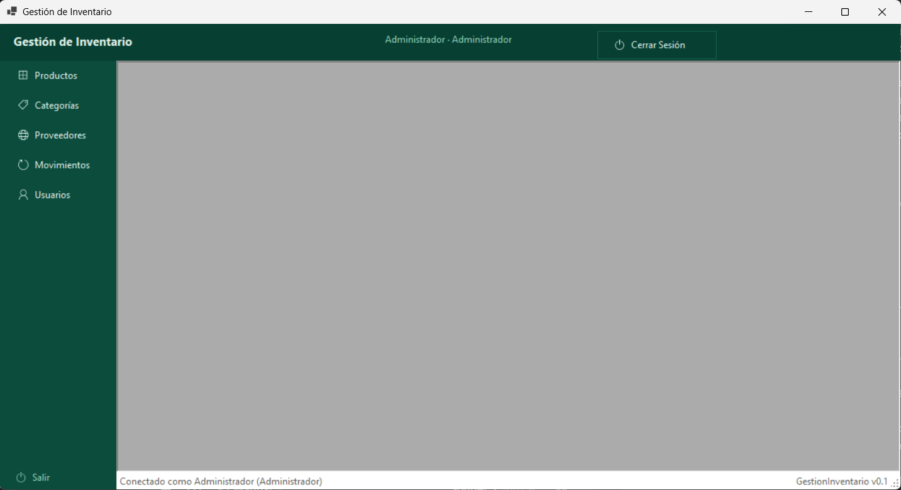
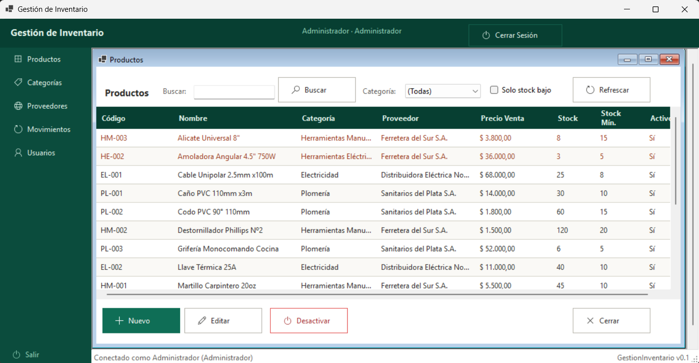
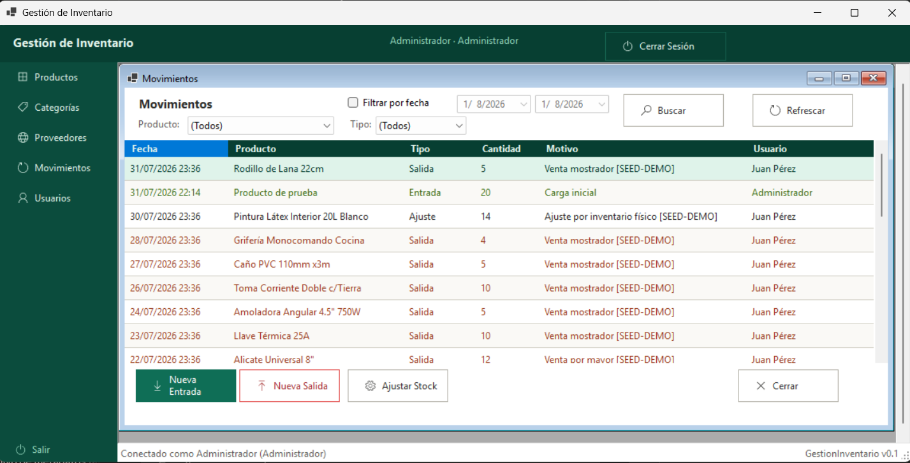
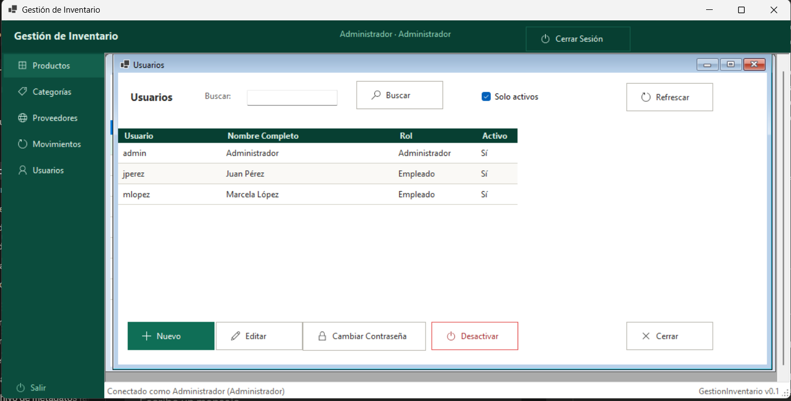

# GestorInventario

Sistema de gestión de inventario y stock para escritorio, desarrollado en **WinForms (.NET 8)** con **Entity Framework Core** y **SQL Server**, siguiendo una arquitectura en capas (Clean Architecture).

Permite administrar productos, categorías, proveedores, usuarios y todo el historial de movimientos de stock (entradas, salidas y ajustes), con control de acceso por roles y una interfaz visual unificada en toda la aplicación.

## Capturas de pantalla

<!--
Reemplazar estas 4 imágenes por capturas reales de la aplicación corriendo,
guardándolas en docs/screenshots/ con estos mismos nombres de archivo.
-->

| Pantalla principal | Productos |
|---|---|
|  |  |

| Movimientos de stock | Usuarios |
|---|---|
|  |  |

## Características principales

- **Login con roles**: acceso diferenciado para Administrador y Empleado (por ejemplo, la gestión de usuarios solo está disponible para administradores).
- **Productos**: alta, edición y baja lógica, con código único, categoría, proveedor opcional, precio de costo/venta, stock actual y stock mínimo. Filtro por texto, categoría y por productos con stock bajo.
- **Categorías**: ABM completo, con validación que impide eliminar una categoría si tiene productos asociados.
- **Proveedores**: ABM completo con razón social, CUIT, contacto y baja lógica (activo/inactivo).
- **Usuarios**: alta, edición de datos y rol, cambio de contraseña por separado, y baja lógica (con protección para que un usuario no pueda desactivarse a sí mismo).
- **Movimientos de stock**: registro de entradas, salidas y ajustes de inventario, con motivo y usuario responsable. Listado con filtro por producto, tipo de movimiento y rango de fechas. El stock de cada producto se actualiza automáticamente al registrar un movimiento.
- **Manejo global de errores**: cualquier excepción no controlada se registra en un log de texto y se informa con un mensaje claro, en lugar de cerrar la aplicación de golpe.
- **Interfaz visual centralizada**: paleta de colores, tipografías, estilos de botón e íconos definidos en un único punto (`Helpers/UiTheme.cs` y `Helpers/UiStyler.cs`), aplicados de forma consistente a todos los formularios sin necesidad de tocar el diseñador de cada pantalla.

## Arquitectura

El proyecto está organizado en 4 capas, dentro de la solución `SistemaEscritorio.slnx`:

- **`GestorInventario.Domain`** — entidades (`Producto`, `Categoria`, `Proveedor`, `Usuario`, `MovimientoStock`), enums (`TipoMovimiento`, `RolUsuario`) e interfaces de repositorio. No depende de ninguna otra capa.
- **`GestorInventario.Application`** — casos de uso y reglas de negocio (`ProductoService`, `CategoriaService`, `ProveedorService`, `UsuarioService`, `StockService`), hashing de contraseñas (PBKDF2). Depende solo de Domain.
- **`GestorInventario.Infrastructure`** — acceso a datos con EF Core 8 (Code First, Fluent API), implementación de los repositorios, migraciones y configuración del `DbContext`.
- **`GestionInventario`** — proyecto WinForms (UI). Contiene los formularios, la configuración de inyección de dependencias (`Program.cs`) y los helpers de estilo visual. Depende de Application e Infrastructure.

La UI se resuelve íntegramente por inyección de dependencias (`Microsoft.Extensions.DependencyInjection`): cada pantalla hija se abre en su propio `IServiceScope`, que se libera al cerrarla.

## Tecnologías

- .NET 8 / C# 12
- Windows Forms
- Entity Framework Core 8 (SQL Server)
- Microsoft.Extensions.DependencyInjection

## Requisitos

- Windows con .NET 8 SDK instalado
- SQL Server (local o remoto)
- Visual Studio 2022 (o posterior) recomendado para abrir la solución

## Instalación y puesta en marcha

1. Cloná el repositorio.
2. Configurá la cadena de conexión en `GestionInventario/App.config` (sección `connectionStrings`, clave `DefaultConnection`).
3. Aplicá las migraciones para crear la base de datos:
   ```
   dotnet ef database update --project GestorInventario.Infrastructure --startup-project GestionInventario
   ```
4. Compilá y ejecutá el proyecto `GestionInventario` (formulario de inicio: `LoginForm`).

## Estructura del proyecto

```
SistemaEscritorio/
├── GestionInventario/              # UI WinForms
│   ├── Forms/
│   │   ├── Login/
│   │   ├── Productos/
│   │   ├── Categorias/
│   │   ├── Proveedores/
│   │   ├── Usuarios/
│   │   └── Movimientos/
│   ├── Helpers/                    # UiTheme, UiStyler, SesionActual
│   └── Program.cs                  # composición de DI
├── GestorInventario.Application/   # servicios / casos de uso
├── GestorInventario.Domain/        # entidades, enums, interfaces
└── GestorInventario.Infrastructure/# EF Core, repositorios, migraciones
```

## Para quienes evalúen adquirir este sistema

Esta base ya cubre el circuito completo de un inventario chico/mediano (productos, categorías, proveedores, usuarios y trazabilidad de stock), pero está pensada como punto de partida: la arquitectura en capas permite sumar módulos sin reescribir lo existente. Algunos de los ajustes y desarrollos a medida que podemos incorporar:

- **Reportes y exportación** a Excel/PDF (stock actual, valorizado de inventario, historial de movimientos por período, productos más vendidos).
- **Alertas automáticas de stock bajo** por email o WhatsApp, en lugar de tener que revisarlo manualmente en la pantalla de Productos.
- **Múltiples depósitos o sucursales**, con transferencias de stock entre ellos.
- **Lector de código de barras** e impresión de etiquetas/códigos para los productos.
- **Facturación electrónica** (integración con AFIP/ARCA) para emitir comprobantes válidos desde el mismo sistema.
- **Módulo de compras**, con órdenes de compra a proveedores y recepción de mercadería.
- **Punto de venta (POS)** integrado, para negocios que venden directo al público.
- **Dashboard con gráficos** de ventas, rotación de stock y rentabilidad por producto.
- **Permisos más granulares**, más allá de Administrador/Empleado (por pantalla o por acción específica).
- **Importación masiva** de productos desde Excel/CSV.
- **Backup automático** de la base de datos a la nube.
- **Versión web o app móvil complementaria**, reutilizando las capas Domain/Application ya construidas.
- **Integración con sistemas contables** (Tango, Xubio, u otros).

Cualquiera de estos puntos, y otros que surjan puntuales del negocio, se pueden cotizar y desarrollar por separado sobre esta misma base.
